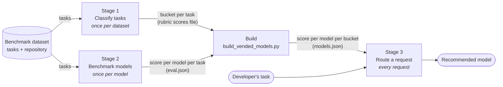
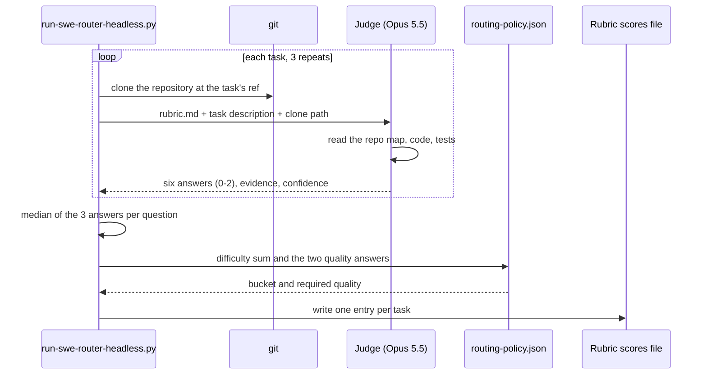
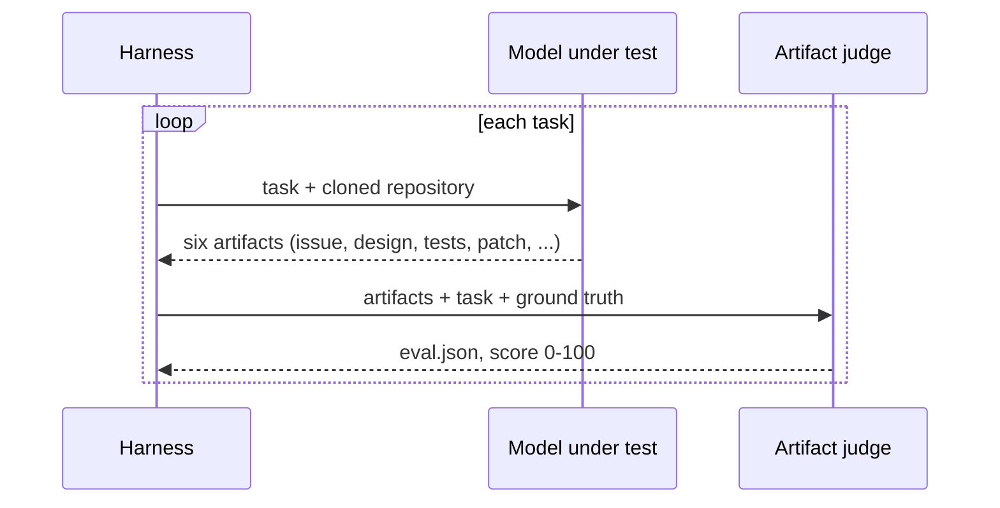
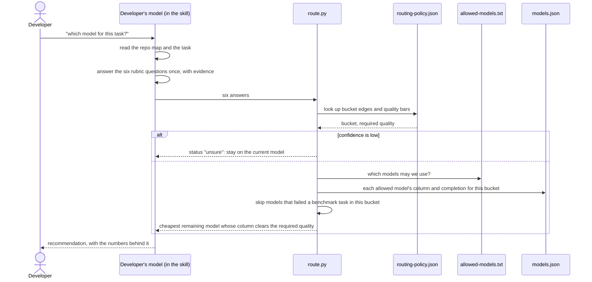

# How swe-router picks a model

`swe-router` tells a developer which model to use for a coding task: the cheapest one their organisation allows that is good enough for that task. The answer depends on the task's difficulty level, which this page calls its **bucket** (easy, moderate, hard or very hard). This page explains the three stages behind that answer. Two run once, on our side, against a benchmark dataset. The third runs every time a developer asks.

> [!IMPORTANT]
> This is how the skill works from version 0.2.0. Earlier versions asked the developer's model to pick a tier and a quality floor in its own words. The rubric replaced that after it routed better on two repositories; see [swe-router-rubric-evaluation.md](swe-router-rubric-evaluation.md) and [results-cli-cli-v1.md](results-cli-cli-v1.md).

> [!NOTE]
> **Terms.**
> **Rubric**: six questions about a coding task, each answered 0, 1 or 2 ([rubric.md](../vend/swe-router/rubric.md)).
> **Bucket**: a task's **difficulty level**: easy, moderate, hard or very hard. This page calls a difficulty level a bucket because the build sorts every benchmark task into one of the four and averages each model's scores per level. Code computes it from four of the six answers.
> **Required quality**: the benchmark score a model must reach for this task. Code computes it from the other two answers.
> **Column**: one model's mean benchmark score over the tasks in one bucket.
> **Artifact judge**: `openai.gpt-5.6-sol`, which grades what a model produced on a benchmark task, 0 to 100.

## How each stage feeds the next

Each arrow below carries the one thing a stage hands to the next.

| Stage | Takes in | Hands on | To |
|---|---|---|---|
| 1. Classify tasks | the dataset's tasks and repository | a bucket for every task | the build |
| 2. Benchmark models | the same tasks | each model's score on every task | the build |
| Build | buckets and scores | each model's mean score in each bucket | stage 3, inside `models.json` |
| 3. Route a request | the developer's task and `models.json` | one recommended model | the developer |

Stages 1 and 2 do not depend on each other. Stage 1 reads only the tasks and the repository, never a model's results. Stage 2 never sees the buckets. They meet only in the build step.

## Stage 1: classify the benchmark tasks

A frontier model reads each benchmark task and its repository and answers the six rubric questions. We use Claude Opus 5.5: on cli/cli its bucket held across all three repeats on 20 of 21 tasks, against 13 for Haiku 5.5.

The judge sees only the questions. The bucket edges and quality numbers live in the policy file.

The result is one file per dataset, such as `docs/metrics/swe-router-rubric-mcp-gateway-registry-v2-claude-opus-5-5.json`. A pass over 21 tasks costs about $20 and takes about 12 minutes. The file changes only when the tasks change or `rubric.md` changes. Benchmarking another model leaves it alone. Details: [swe-router-rubric-scores.md](swe-router-rubric-scores.md).

### How the six answers become a bucket and a required quality

Each question takes 0, 1 or 2. The short anchors below summarise [rubric.md](../vend/swe-router/rubric.md), which gives the judge the full wording. The first four questions measure how hard the task is and set the **bucket**. The last two measure what a mistake would cost and set the **required quality**, the quality floor a model's work must reach.

| Question | 0 | 1 | 2 | Sets |
|---|---|---|---|---|
| hidden_contract: is the right behaviour defined outside the task? | the task states it completely | nearby code or project conventions imply it | something outside the change fixes it: an earlier issue, another service's contract, a spec | bucket |
| silent_invariant: could a wrong change look like it works? | a mistake is visible: an error, a wrong value | a mistake shows only in edge cases: unusual input, another config or platform | a security, data or concurrency mistake fails silently | bucket |
| coordinated_surfaces: how many places must change together? | one | two or three inside one component | several components or layers, such as the API, the CLI and the deployment config | bucket |
| ambiguity: is there a tempting narrower fix? | one obvious reading, and the obvious fix is right | some interpretation; the repository makes the answer clear | a narrower fix would pass a quick review and still miss the real problem | bucket |
| verification: would the repository's tests catch a mistake? | strong tests cover it | some tests, with gaps | no meaningful tests | required quality |
| blast_radius: what happens if it ships wrong? | throwaway or internal; a mistake costs a rerun | users would notice; a revert fixes it | security, money or data loss, or hard to undo | required quality |

**Bucket.** The four difficulty answers add up to a sum from 0 to 8:

| Sum | 0-1 | 2-3 | 4-5 | 6-8 |
|---|---|---|---|---|
| Bucket | easy | moderate | hard | very hard |

**Required quality.** `blast_radius` sets the floor, and `verification` adds 5 points when it is 2, since nothing would catch a mistake before it ships:

| blast_radius | Required quality | With verification 2 |
|---|---:|---:|
| 0 | 60 | 65 |
| 1 | 70 | 75 |
| 2 | 75 | 80 |

These numbers sit on the artifact judge's 0-100 scale. 60 is the bottom of its "strong" band, 75 the top, and 80 approaches its "excellent" band. [routing-policy.json](../vend/swe-router/routing-policy.json) holds both tables, so a platform team can change them.

Stage 1 records both results for every benchmark task, but the build uses only the bucket. The required quality matters in stage 3, where the developer's model answers the same two questions about their own task.

## Stage 2: benchmark the models

Every model under test runs every task in the same dataset, and the artifact judge grades the result. This is the benchmark the repository already runs ([benchmarks/README.md](../benchmarks/README.md)).

A model that leaves its artifacts in the wrong place, or produces none, counts as a failure on that task.

### The build step joins stages 1 and 2

`build_vended_models.py` files each score under its task's bucket and averages per bucket:

| Task | Bucket (stage 1) | Haiku 5.5 | Sonnet 5.5 | Opus 5.5 |
|---|---|---:|---:|---:|
| default-create-in-idp-checkbox-unchecked | hard | 76.8 | 83.0 | 75.0 |
| fix-reserved-groups-var-in-service-account-script | hard | 82.4 | 82.0 | 86.8 |
| cli-custom-egress-oauth-provider-flags | hard | 76.6 | 86.4 | 88.0 |
| ... 7 more hard tasks | hard | | | |
| **Column: mean of the 10 hard tasks** | | **76.5** | **80.1** | **80.4** |

Doing this for every bucket gives `models.json`. On the v2 dataset:

| Model | Cost per task | moderate | hard | very hard |
|---|---:|---:|---:|---:|
| Haiku 5.5 | $0.14 | 83.2 | 76.5 | 65.3 (8 of 9 finished) |
| Sonnet 5.5 | $2.62 | 86.5 | 80.1 | 77.2 |
| Opus 5.5 | $4.44 | 89.7 | 80.4 | 80.2 |

Source: Opus 5.5's rubric file for buckets, each model's `run-summary.json` under `benchmarks/swe-benchmark-data/<model>/omp/swe3/mcp-gateway-registry-v2/` for scores and cost. v2 has no task in the easy bucket.

## Stage 3: route a developer's task

The developer runs the skill in their coding agent with whatever model they already use.

The developer's model answers the same six questions, and `route.py` turns them into a bucket and a required quality with the tables in [stage 1](#how-the-six-answers-become-a-bucket-and-a-required-quality).

Three worked requests against the v2 columns above, choosing among the three Claude 5.5 models:

| The developer's model answers | Bucket | Required | Haiku | Sonnet | Opus | Pick |
|---|---|---:|---:|---:|---:|---|
| difficulty sum 5, blast radius 1, verification 1 | hard | 70 | 76.5 | 80.1 | 80.4 | Haiku, the cheapest that clears |
| difficulty sum 5, blast radius 2, verification 2 | hard | 80 | 76.5 | 80.1 | 80.4 | Sonnet, the cheapest that clears, by 0.1 points |
| difficulty sum 6, blast radius 1, verification 1 | very hard | 70 | 65.3 | 77.2 | 80.2 | Sonnet; Haiku is also skipped, having failed 1 of the 9 very hard tasks |

If the developer's model reports low confidence in its answers, `route.py` returns `unsure` and the skill keeps the developer on their current model. If the benchmark has no task in the bucket, as v2 has none in easy, `route.py` reads the next harder bucket, which can only understate a model.

## Why the same rubric on both sides

The benchmark tasks (stage 1) and the developer's task (stage 3) go through the same six questions. That keeps "hard" meaning the same thing in the column and in the request. The benchmark tasks get three judgments from a frontier model because every request compares against their columns. The developer's task gets one judgment from whatever model they run, to keep each request quick and cheap.

## What updates when

| Event | Stage 1 (rubric file) | Stage 2 (benchmark) | Build (`models.json`) |
|---|---|---|---|
| New model to evaluate | no change | run it on the dataset | rebuild |
| New dataset | new pass, about $20 | run every model on it | rebuild |
| Tasks added or removed | new pass | run the new tasks | rebuild |
| `rubric.md` questions change | new pass | no change | rebuild |
| A bar or bucket edge in `routing-policy.json` moves | no pass; recompute buckets from the stored answers | no change | rebuild |

## Known limits

- Each column averages a handful of tasks run once each. Differences under 3 points are noise, which is why the router treats them as ties.
- A column mean leaves out a model's failed tasks, so `route.py` skips a model that failed any benchmark task in the bucket (`min_completion_in_bucket` in the policy). That catches failures the benchmark recorded and no others: Haiku 5.5 finished all 10 hard v2 tasks, then failed a hard cli/cli task by writing to the wrong folder ([results-cli-cli-v1.md](results-cli-cli-v1.md)).
- The developer's model judges once. A cheaper model gives less consistent answers: Haiku 5.5's bucket changed between repeats on 8 of 21 cli/cli tasks.
