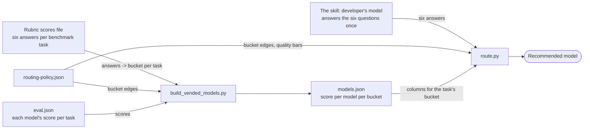

# The rubric scores file: what it is, how it is made, and who reads it

Files named `docs/metrics/swe-router-rubric-<dataset>-<judge>.json` record how hard each benchmark task is, as judged with the swe-router rubric. Each task gets a difficulty level, which these docs call its **bucket**: easy, moderate, hard or very hard. This page explains what they hold, how they are made, when they change, and how they relate to the `swe-router` skill.

**Short answer:** the skill never opens this file. It is a build input: `build_vended_models.py` reads it to sort each model's benchmark scores into per-bucket columns in `models.json`, and the skill reads `models.json`. It is also the evidence that the rubric routes better than what came before; see [What the evidence showed](#what-the-evidence-showed).

> [!NOTE]
> **Terms.**
> **Rubric**: six questions about a coding task, each scored 0, 1 or 2 ([rubric.md](../vend/swe-router/rubric.md)).
> **Judge**: the model that answers those questions. Here, Claude Opus 5.5.
> **Bucket**: a task's **difficulty level**: easy, moderate, hard or very hard. These docs call a difficulty level a bucket because the build sorts every benchmark task into one of the four and averages each model's scores per level. Code computes it from four of the six answers.
> **Required quality**: the score a result must reach, from the other two scores.
> **Column**: a model's mean benchmark score over the tasks in one bucket.
> **Artifact judge**: `openai.gpt-5.6-sol`, which grades what a model *produced* on a task. A different job from the rubric judge, which grades the *task*.

## What the file holds

One file covers one dataset and one judge:

| File | Role |
|---|---|
| `swe-router-rubric-mcp-gateway-registry-v2-claude-opus-5-5.json` | v2 tasks, judged by Opus 5.5. The shipped `models.json` is built from this one |
| `swe-router-rubric-mcp-gateway-registry-v2-claude-haiku-5-5.json` | v2 tasks, judged by Haiku 5.5. Evidence that a cheap judge is less steady |
| `swe-router-rubric-cli-cli-v1-claude-opus-5-5.json` | cli/cli tasks, judged by Opus 5.5. Used for the cross-repo check in #221 |
| `swe-router-rubric-cli-cli-v1-claude-haiku-5-5.json` | cli/cli tasks, judged by Haiku 5.5 |

Each file has three parts:

- **`judged_by`**: the judge, harness, dataset, repeat count, start and finish times, and what the pass cost.
- **`tasks`**: one entry per task. `scores` holds the six numbers used for routing. `bucket` and `required_quality` are what code computed from them. `scores_seen` and `buckets_seen` keep each repeat's answer, so you can see where the judge wavered.
- **`judgments`**: the raw output of every run, kept for audit.

Here is one task from the v2 Opus file, trimmed:

```json
"default-create-in-idp-checkbox-unchecked": {
  "scores": {"hidden_contract": 1, "silent_invariant": 1, "coordinated_surfaces": 2,
             "ambiguity": 1, "verification": 1, "blast_radius": 1},
  "difficulty_sum": 5,
  "bucket": "hard",
  "required_quality": 70.0,
  "scores_seen": {"hidden_contract": [1, 1, 2], "ambiguity": [1, 1, 2], "...": "..."}
}
```

The file says nothing about any model's results. It describes the task.

## How it is made

[run-swe-router-headless.py](../benchmarks/scripts/run-swe-router-headless.py) in rubric mode makes it:

```bash
cd benchmarks
uv run python scripts/run-swe-router-headless.py --mode rubric \
    --agent omp --provider bedrock --model us.anthropic.claude-opus-5-5 \
    --dataset dataset/cli-cli-v1.yaml --repeats 3
```

For each task in the dataset, the script:

1. clones the repository at the task's ref;
2. starts a fresh agent session with [rubric.md](../vend/swe-router/rubric.md) and the task description, and tells it to score the six questions and change nothing;
3. reads the six scores and a confidence level from the agent's final message;
4. repeats this three times, since one run can put a borderline task in the wrong bucket;
5. takes each score's median, rounding down to keep it 0, 1 or 2 (`[1, 1, 2]` becomes 1);
6. computes the bucket and required quality from those medians with [routing-policy.json](../vend/swe-router/routing-policy.json).

The judge never sees the numbers 60, 70 or 75, nor the bucket edges. It answers questions about the task, and the policy file turns the answers into numbers. Without `--out`, the script names the file after the dataset and the judge.

| Pass | Judgments | Cost | Time |
|---|---:|---:|---:|
| v2, Opus 5.5 | 63 | $20.23 | 12 min |
| v2, Haiku 5.5 | 62 of 63 | $0.84 | 11 min |
| cli/cli, Opus 5.5 | 63 | $15.59 | 13 min |
| cli/cli, Haiku 5.5 | 63 | $0.63 | 11 min |

Source: the `judged_by` block of each file.

## When it changes

The bucket belongs to the task, not to any model, so benchmarking more models leaves the file alone.

| Event | What happens to the file |
|---|---|
| A new model is benchmarked | Nothing. Its scores go into the buckets already recorded |
| A model is re-run | Nothing |
| A task is added to or removed from the dataset | Run a new pass (about $20, 12 minutes) |
| A new dataset | A new file for that dataset |
| `rubric.md` changes its questions or anchors | Run a new pass, because the scores now mean something else |
| `routing-policy.json` moves a bar or a bucket edge | No new pass. Recompute bucket and required quality from the stored scores |

That last row works because the file stores the six raw scores. A platform team can move a bucket edge in a diff without paying for another pass.

## How the skill relates to it



The file sits on the build side, left of `models.json`. The skill ships `SKILL.md`, `rubric.md`, `routing-policy.json`, `route.py`, `models.json`, `model-aliases.json` and `allowed-models.txt`. It does not ship this file and never reads it. The file's buckets reach the developer only through the columns in `models.json`.

The build recomputes each bucket from the stored `scores` with the current policy and ignores the stored `bucket` field, so a policy change can never leave a stale bucket. Only one file per dataset feeds the build: the Opus 5.5 one, whose bucket held across all three repeats on 20 of 21 cli/cli tasks, against 13 for Haiku 5.5.

Both sides use the same `rubric.md`. The judge bucketed the benchmark tasks with those six questions, and `route.py` buckets the developer's task with the same six, which keeps "hard" meaning the same thing on both sides of the comparison. The benchmark tasks get three judgments each, because every routing decision compares against their columns. The developer's task gets one, to keep each request quick and cheap.

### What the evidence showed

Before version 0.2.0 the skill asked the developer's model for a quality floor and one of four tiers in its own words, and read columns grouped by the tier written by hand in the dataset file. [eval_swe_router.py](../benchmarks/scripts/eval_swe_router.py) replayed both ways of routing over every benchmark task, then looked up what the chosen model scored and cost on that task:

- On v2, against all 23 models, the rubric saved more (75.3% against 70.5%), lost less quality (−3.75 against −5.06 points) and missed the required quality on fewer tasks (4 against 9). Skipping models with failures in the bucket, as 0.2.0 does, gives 74.7% and −3.22. See [swe-router-rubric-evaluation.md](swe-router-rubric-evaluation.md).
- On cli/cli, columns built from v2 alone routed a Go repository with no adjustment and erred towards the stronger model. See [results-cli-cli-v1.md](results-cli-cli-v1.md).

## Summary of roles

| Thing | Made by | Read by | Shipped in the skill |
|---|---|---|---|
| `rubric.md` | us, by hand | the rubric judge, and the developer's model at run time | yes |
| `routing-policy.json` | the platform team | the rubric pass, `build_vended_models.py`, `route.py`, the replay | yes |
| Rubric scores file | `run-swe-router-headless.py --mode rubric` | `build_vended_models.py`, the replay | no |
| `eval.json` per task | the artifact judge | `build_vended_models.py`, the replay | no |
| `models.json` | `build_vended_models.py` | `route.py` | yes |
